## Identitas Mahasiswa

- Nama: Md. Pradiptha Pradnyaswari
- NIM: 2415051055
- Kelas: PTI 5C
- Mata Kuliah: Pemrograman Berbasis Mobile

# Finote – Personal Finance Manager

Finote adalah aplikasi pengelola keuangan pribadi berbasis Flutter yang dirancang untuk membantu pengguna mencatat pemasukan dan pengeluaran, memantau kondisi keuangan, serta memahami pola transaksi secara lebih terstruktur.

## Fitur Utama

- **Dashboard:** Menampilkan saldo, total pemasukan, total pengeluaran, dan transaksi terbaru.
- **Manajemen Transaksi:** Menambahkan, melihat, mengedit, dan menghapus transaksi.
- **Analisis Keuangan:** Menampilkan ringkasan dan grafik pemasukan serta pengeluaran berdasarkan periode harian, mingguan, bulanan, dan tahunan.
- **Kategori Transaksi:** Mengelompokkan transaksi berdasarkan kategori pemasukan dan pengeluaran.
- **Pencarian dan Filter:** Mencari transaksi serta memfilter berdasarkan jenis, kategori, dan rentang tanggal.
- **Kurs Mata Uang:** Mengambil nilai tukar USD ke IDR melalui ExchangeRate-API.
- **Pengaturan Tema:** Mendukung Light, Dark, dan System dengan penyimpanan preferensi tema.
- **Notifikasi:** Menampilkan dan mengelola riwayat notifikasi transaksi.
- **Tips Keuangan:** Menampilkan tips pengelolaan keuangan dari data JSON lokal.
- **Privasi Saldo:** Memungkinkan pengguna menyembunyikan dan menampilkan nominal saldo pada dashboard.

## Teknologi yang Digunakan

- Flutter dan Dart
- Supabase (PostgreSQL)
- Provider dan ChangeNotifier
- ExchangeRate-API
- Shared Preferences

## Struktur Proyek

```text
lib/
├── models/
├── providers/
├── repositories/
├── screens/
├── services/
├── utils/
├── widgets/
├── app.dart
└── main.dart
```

## Konfigurasi dan Cara Menjalankan

1. Pastikan Flutter SDK dan Android SDK sudah terpasang.
2. Clone repository:

   ```bash
   git clone https://github.com/pradipthapradnyaswari/UTS_2415051055_Md_Pradiptha_Pradnyaswari.git finote
   cd finote
   ```

3. Instal dependensi:

   ```bash
   flutter pub get
   ```

4. Siapkan project Supabase dan tabel `transactions` sesuai struktur database aplikasi.
5. Jalankan aplikasi dengan konfigurasi Supabase:

   ```bash
   flutter run -d chrome --dart-define="SUPABASE_URL=YOUR_SUPABASE_URL" --dart-define="SUPABASE_PUBLISHABLE_KEY=YOUR_SUPABASE_PUBLISHABLE_KEY"
   ```

Ganti `YOUR_SUPABASE_URL` dan `YOUR_SUPABASE_PUBLISHABLE_KEY` dengan konfigurasi project Supabase milik pengguna.

Untuk menjalankan aplikasi pada perangkat Android, ganti `-d chrome` dengan ID perangkat Android yang terdeteksi melalui perintah `flutter devices`.

Jangan memasukkan Secret Key atau Service Role Key ke dalam aplikasi Flutter maupun repository publik.

## API

Finote menggunakan ExchangeRate-API untuk memperoleh nilai tukar USD terhadap IDR.

Endpoint:

```text
https://open.er-api.com/v6/latest/USD
```

Data API diproses menjadi model Dart dan ditampilkan pada halaman Beranda.

Sumber: [ExchangeRate-API](https://www.exchangerate-api.com/)

## Pengujian

Pengujian Finote dilakukan melalui pemeriksaan statis, pengujian widget sederhana, dan pengujian fungsional secara manual.

### Pemeriksaan Otomatis

Jalankan perintah berikut:

```bash
dart format lib
flutter analyze
flutter test
```

Widget test yang tersedia memeriksa apakah aplikasi Finote berhasil ditampilkan dan teks identitas aplikasi muncul pada halaman utama.

### Pengujian Fungsional Manual

Pengujian manual mencakup:
- Menambahkan, melihat, mengedit, dan menghapus transaksi.
- Pencarian dan filter transaksi.
- Perhitungan saldo dan analisis keuangan.
- Pengaturan serta penyimpanan tema.
- Pengambilan nilai tukar USD ke IDR.
- Notifikasi transaksi.
- Validasi dan penyimpanan feedback ke Supabase.

## Repository

[GitHub – Finote](https://github.com/pradipthapradnyaswari/UTS_2415051055_Md_Pradiptha_Pradnyaswari)

## Catatan Keamanan

RLS (Row Level Security) telah diaktifkan pada tabel `transactions`.
Namun, konfigurasi policy pada versi demonstrasi UTS ini masih
mengizinkan role `anon` melakukan operasi SELECT, INSERT, UPDATE,
dan DELETE tanpa pembatasan akses berdasarkan identitas pengguna.

Karena aplikasi belum menggunakan autentikasi dan pembatasan data
per pengguna, konfigurasi ini hanya ditujukan untuk demonstrasi
dan pengujian. Jangan gunakan data keuangan pribadi atau data sensitif.

Publishable Key digunakan untuk koneksi aplikasi, sedangkan
Secret Key atau Service Role Key tidak boleh dimasukkan ke dalam
aplikasi Flutter maupun repository publik.

## Arsitektur Aplikasi

Finote menggunakan pendekatan arsitektur berlapis untuk memisahkan tanggung jawab antarkomponen agar kode lebih terstruktur dan mudah dikembangkan.

### Tanggung Jawab Setiap Folder

- **models/**: Mendefinisikan struktur data aplikasi dalam bentuk class Dart, seperti TransactionModel, ExchangeRateModel, NotificationModel, dan FinancialTip.
- **providers/**: Mengelola shared state menggunakan ChangeNotifier dan menyediakan data serta fungsi kepada UI melalui Provider.
- **repositories/**: Mengelola proses pengambilan dan pengelolaan data, termasuk operasi CRUD transaksi dan pengambilan data kurs.
- **services/**: Menangani komunikasi dengan layanan eksternal, pengambilan data API, pembacaan aset JSON, inisialisasi Supabase, dan notifikasi perangkat.
- **screens/**: Menampung halaman utama aplikasi dan halaman yang berinteraksi langsung dengan pengguna.
- **widgets/**: Menampung komponen UI yang dapat digunakan kembali, seperti BalanceCard, SummaryCard, dan ExchangeRateCard.
- **utils/**: Menyediakan fungsi bantuan, konstanta, dan format data yang digunakan oleh aplikasi.
- **app.dart**: Mengatur konfigurasi aplikasi, tema, serta penyediaan Provider pada widget tree.
- **main.dart**: Menjadi titik awal aplikasi dan melakukan inisialisasi layanan yang diperlukan.

### Alur Pengelolaan Data

**1. Transaksi**

UI → TransactionProvider → TransactionRepository → SupabaseService → Supabase PostgreSQL

TransactionProvider mengelola state transaksi, sedangkan TransactionRepository menangani operasi CRUD ke database melalui client Supabase.

**2. Kurs Mata Uang**

UI → ExchangeRateProvider → ExchangeRateRepository → ExchangeRateService → ExchangeRate-API

Data kurs diperoleh melalui REST API, kemudian diproses menjadi ExchangeRateModel sebelum ditampilkan pada UI.

**3. Tips Keuangan**

FinancialTipsSection → FinancialTipService → JSON Lokal → FinancialTipModel

Tips keuangan dibaca dari aset JSON lokal dan ditampilkan menggunakan FutureBuilder untuk menangani proses loading, error, dan data berhasil.

**4. Notifikasi**

UI → NotificationProvider → SharedPreferences

NotificationProvider mengelola riwayat notifikasi dan menyimpan datanya secara lokal. NotificationService digunakan untuk menampilkan notifikasi pada perangkat.

### State Management

Finote menggunakan kombinasi local state dan shared state.

- **Local state** dikelola menggunakan setState untuk kebutuhan yang terbatas pada widget atau halaman, seperti pemilihan filter, input formulir, dan navigasi halaman.
- **Shared state** dikelola menggunakan Provider dan ChangeNotifier untuk data yang digunakan oleh beberapa bagian aplikasi, seperti transaksi, tema, notifikasi, dan kurs mata uang.
- **ValueNotifier** digunakan pada BalanceCard untuk mengelola visibilitas nominal saldo.
- **ValueListenableBuilder** mendengarkan perubahan ValueNotifier dan memperbarui tampilan saldo tanpa perlu membangun ulang seluruh halaman.

Provider menggunakan context.watch untuk membaca state yang perlu memperbarui UI ketika terjadi perubahan, sedangkan context.read digunakan untuk memanggil fungsi atau melakukan akses tanpa berlangganan perubahan state.

## Database

Finote menggunakan Supabase PostgreSQL sebagai basis data dengan tabel `transactions` untuk menyimpan data pemasukan dan pengeluaran pengguna.

### Struktur Tabel `transactions`

| Kolom | Tipe Data | Keterangan |
|---|---|---|
| `id` | UUID | Primary Key, dibuat otomatis menggunakan `gen_random_uuid()` |
| `title` | TEXT | Judul transaksi, wajib diisi |
| `amount` | NUMERIC | Nominal transaksi, wajib diisi |
| `type` | TEXT | Jenis transaksi (income/expense) |
| `category` | TEXT | Kategori transaksi |
| `note` | TEXT | Catatan tambahan, opsional |
| `transaction_date` | DATE | Tanggal transaksi |
| `created_at` | TIMESTAMPTZ | Waktu data dibuat |
| `updated_at` | TIMESTAMPTZ | Waktu data diperbarui |

### SQL Pembuatan Tabel

Berikut merupakan perintah SQL yang merepresentasikan struktur tabel
`transactions` pada database Supabase yang digunakan oleh Finote.
SQL ini disertakan sebagai dokumentasi struktur database dan
bukan instruksi untuk membuat ulang tabel yang sudah tersedia.

```sql
CREATE TABLE public.transactions (
    id UUID PRIMARY KEY DEFAULT gen_random_uuid(),
    title TEXT NOT NULL,
    amount NUMERIC NOT NULL CHECK (amount > 0),
    type TEXT NOT NULL CHECK (type IN ('income', 'expense')),
    category TEXT NOT NULL,
    note TEXT DEFAULT '',
    transaction_date DATE NOT NULL DEFAULT CURRENT_DATE,
    created_at TIMESTAMPTZ DEFAULT now(),
    updated_at TIMESTAMPTZ DEFAULT now()
);
```

### Operasi Database

Finote menggunakan Supabase PostgreSQL untuk menyimpan dan
mengelola data transaksi. Pengelolaan data dilakukan melalui
empat operasi CRUD menggunakan Supabase Client.

- **Create (INSERT):** Menambahkan transaksi pemasukan atau
  pengeluaran baru ke tabel `transactions`.
- **Read (SELECT):** Mengambil seluruh data transaksi dari tabel
  `transactions` dan mengurutkannya berdasarkan tanggal transaksi
  serta waktu pembuatan data.
- **Update (UPDATE):** Memperbarui informasi transaksi berdasarkan
  ID transaksi. Kolom `updated_at` juga diperbarui ketika transaksi
  diedit.
- **Delete (DELETE):** Menghapus data transaksi berdasarkan ID
  transaksi.

Operasi CRUD dikelola melalui `TransactionRepository`, sedangkan
`TransactionProvider` mengatur state dan memperbarui tampilan
aplikasi setelah operasi database dilakukan.

### Struktur Tabel `feedback`

Tabel `feedback` digunakan untuk menyimpan komentar atau masukan pengguna melalui halaman Profil.

| Kolom | Tipe Data | Keterangan |
|---|---|---|
| `id` | UUID | Primary Key, dibuat otomatis menggunakan `gen_random_uuid()` |
| `name` | TEXT | Nama mahasiswa, wajib diisi |
| `student_id` | TEXT | NIM mahasiswa, wajib diisi |
| `comment` | TEXT | Isi feedback, wajib minimal 5 karakter setelah spasi awal dan akhir dihapus |
| `created_at` | TIMESTAMPTZ | Waktu feedback dibuat, otomatis menggunakan `now()` |

### Operasi Feedback

Pengiriman feedback dilakukan melalui `FeedbackRepository` menggunakan Supabase Client.

- **Create (INSERT):** Menyimpan nama, NIM, dan komentar pengguna ke tabel `feedback`.
- **Validasi:** Komentar wajib diisi dan minimal 5 karakter.
- **Otomatisasi Database:** ID dan waktu pembuatan data dibuat otomatis oleh database menggunakan `gen_random_uuid()` dan `now()`.

Policy RLS pada tabel `feedback` mengizinkan role `anon` melakukan INSERT. Pengguna tidak diberikan akses SELECT, UPDATE, atau DELETE melalui policy tersebut.


## Screenshot Aplikasi

### Beranda
| Bagian Atas | Bagian Bawah |
|---|---|
| 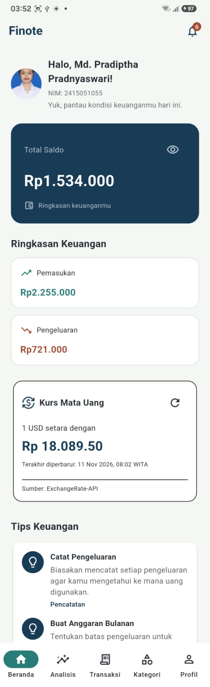 | 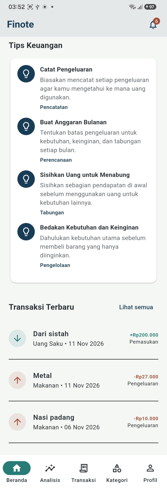 |

### Fitur Utama
| Analisis Keuangan | Daftar Transaksi |
|---|---|
| 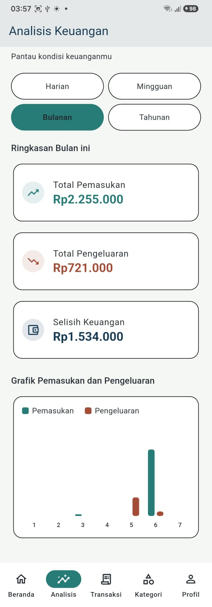 | 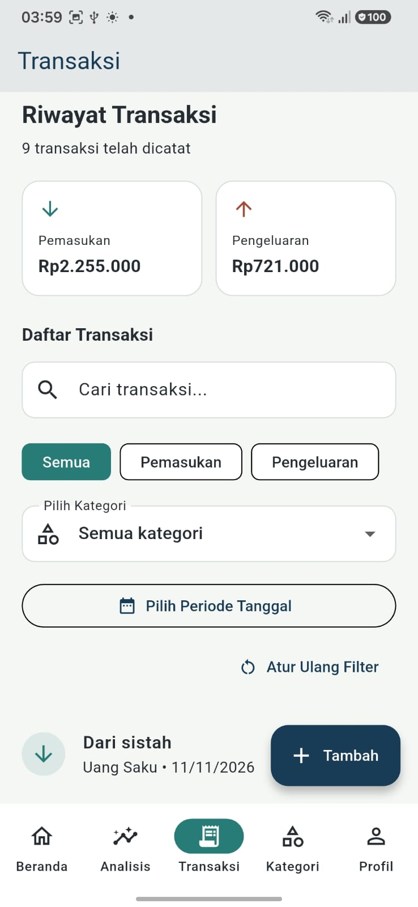 |

| Tambah Transaksi | Detail Transaksi |
|---|---|
| 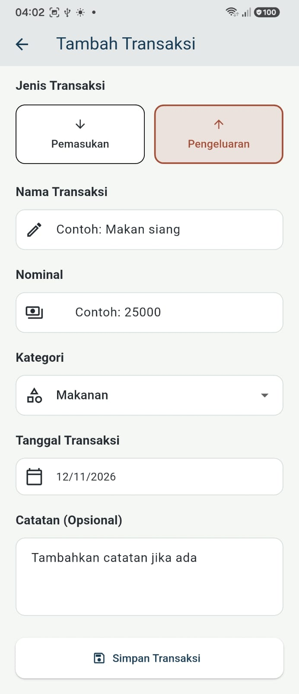 | 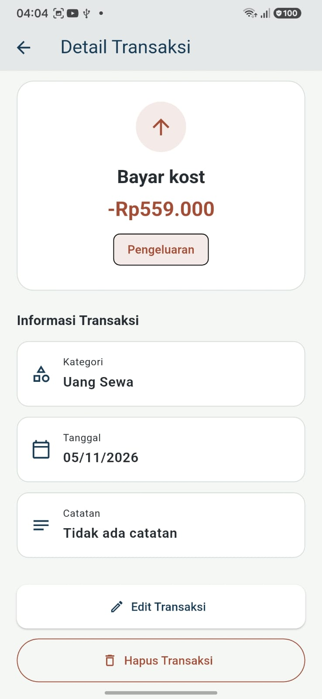 |

| Kategori | Detail Kategori |
|---|---|
| 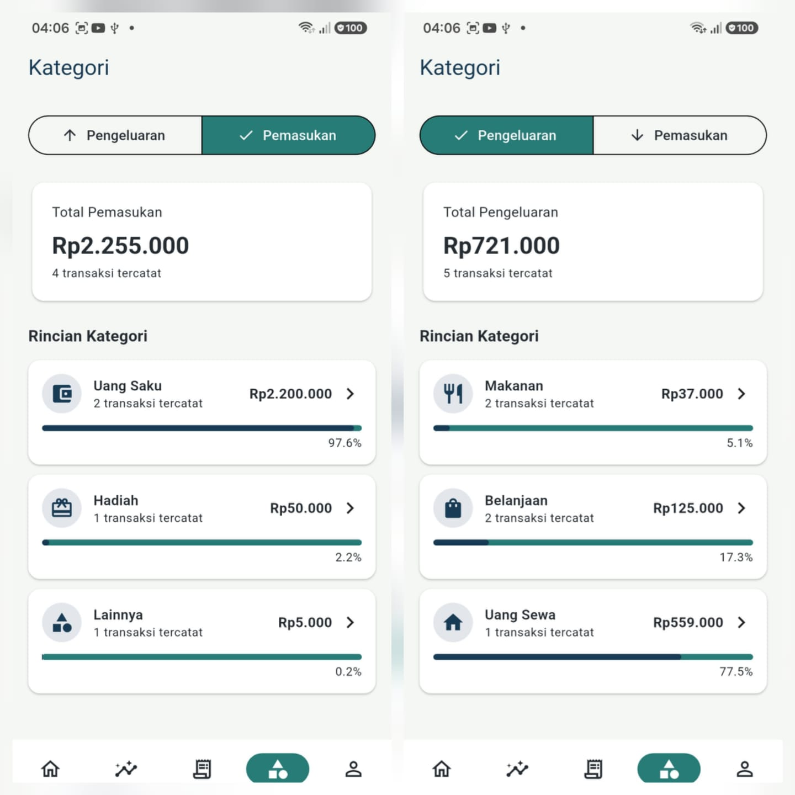 | 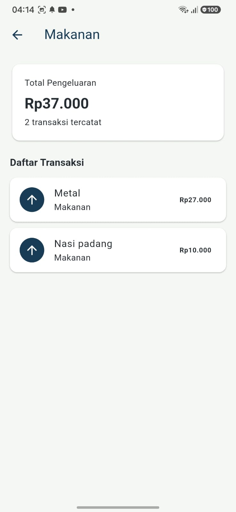 |

### Notifikasi dan Profil
| Notifikasi Aplikasi | Notifikasi Android |
|---|---|
| 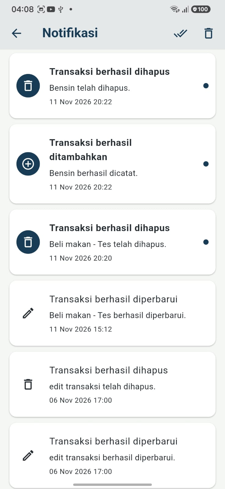 | 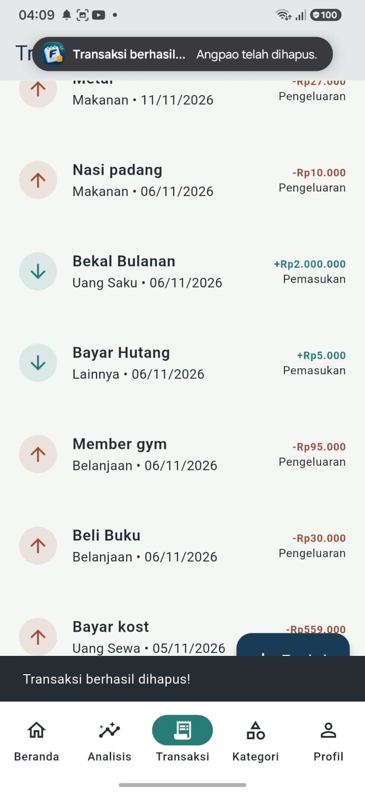 |

| Profil | Feedback |
|---|---|
| 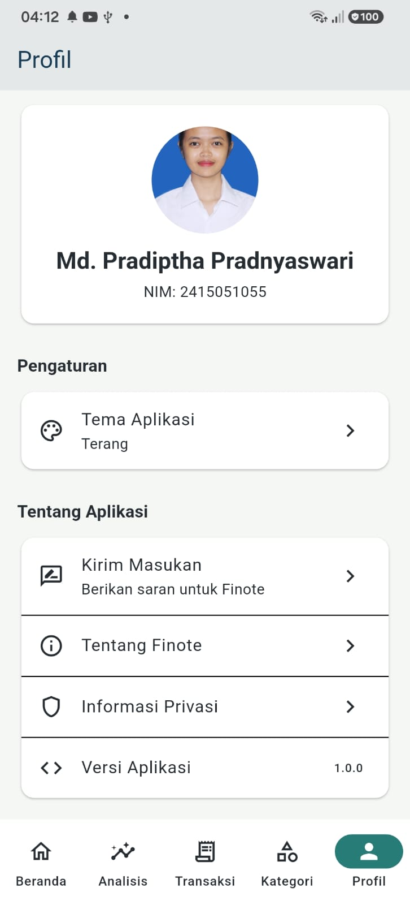 | 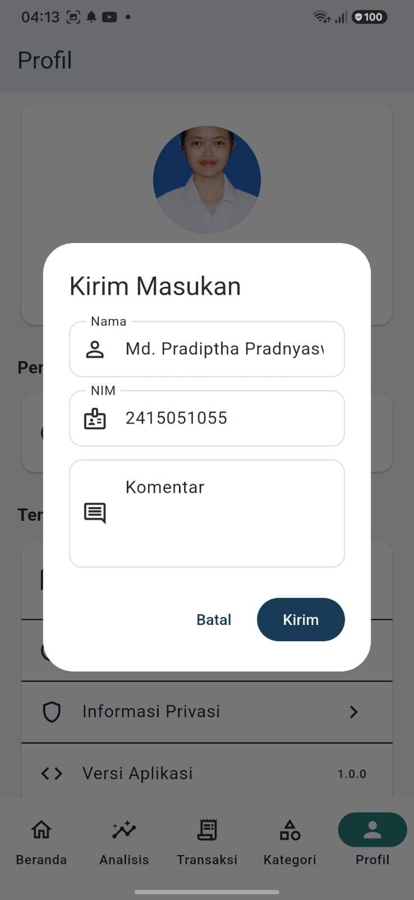 |

### Tampilan dan Responsivitas
| Dark Mode | Desktop View |
|---|---|
| 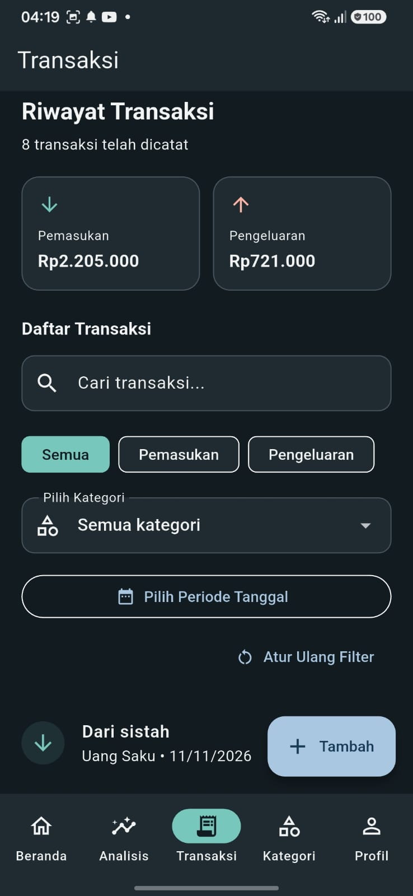 | 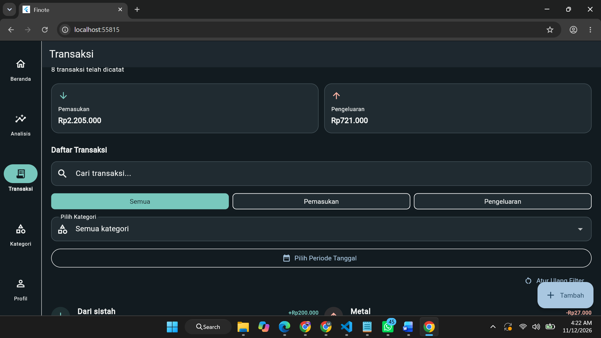 |

### Edit dan Hapus Transaksi

| Edit Transaksi | Konfirmasi Penghapusan |
|---|---|
| 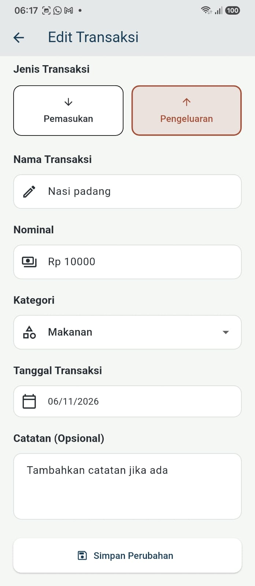 | 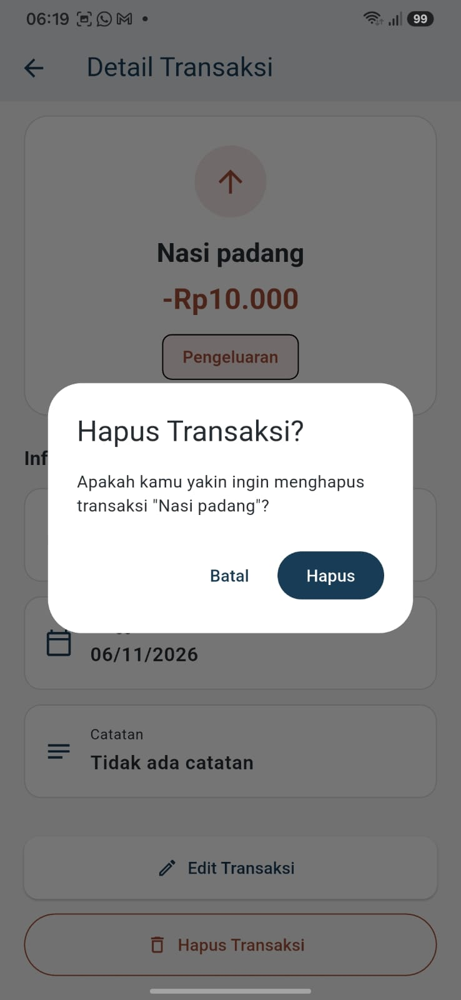 |

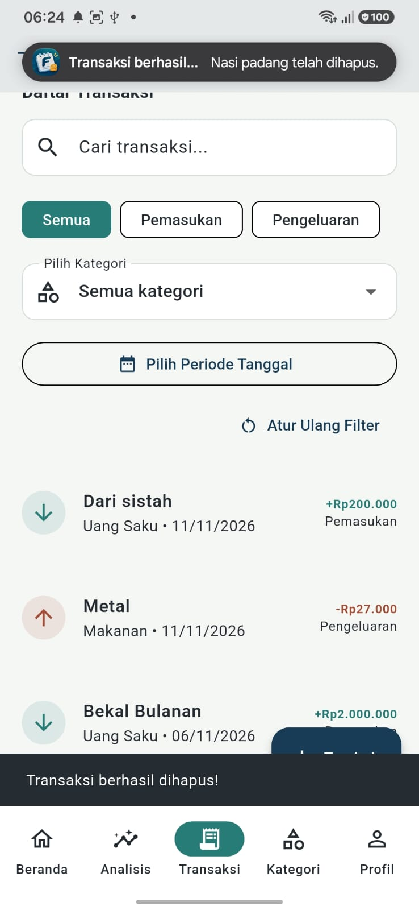

### Integrasi REST API

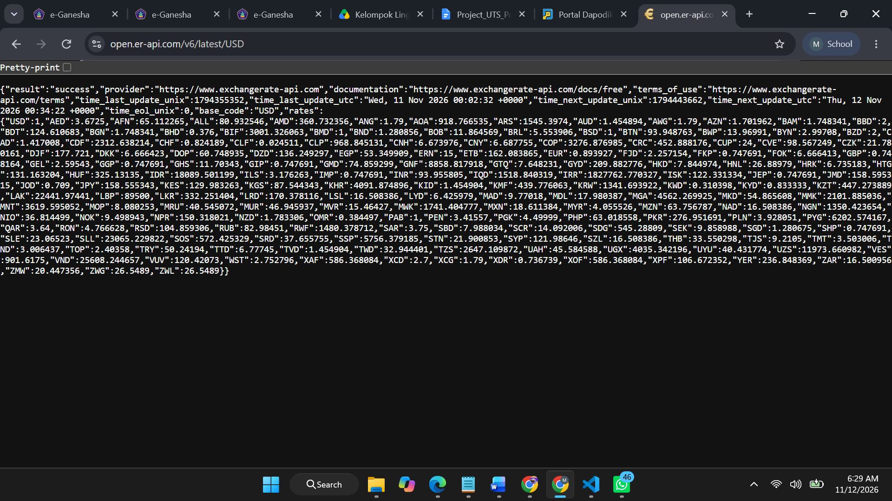

### Database Supabase

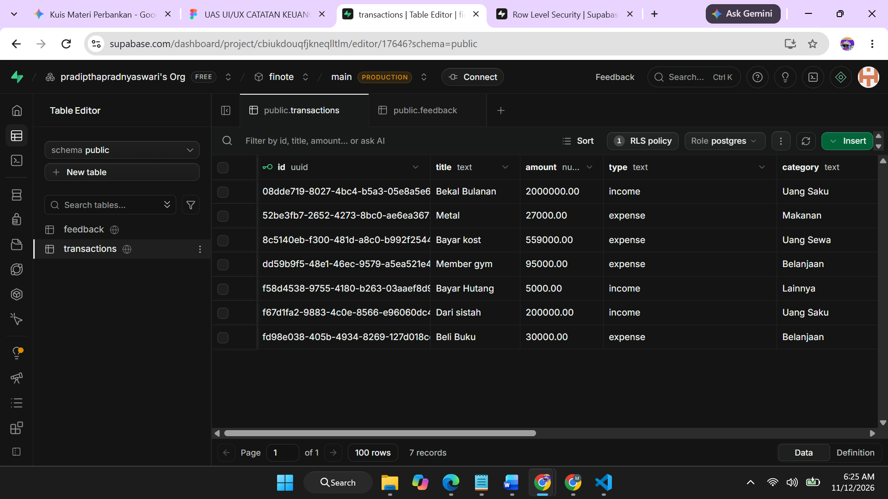